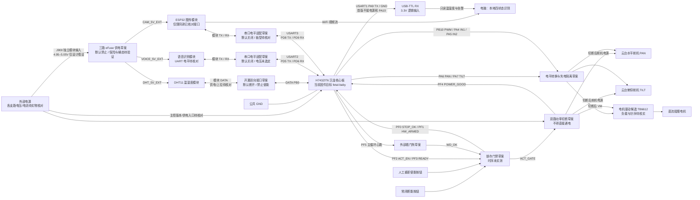

# 智能婴儿陪护舱硬件连线图

## 当前现场入口：H743 信息链路

更新：2026-10-20。[两页接线速查 PDF](output/pdf/h743-info-wiring-20261020-02/H743-information-chain-wiring.pdf)及[第一页预览](output/pdf/h743-info-wiring-20261020-02/page-1.png)、[第二页预览](output/pdf/h743-info-wiring-20261020-02/page-2.png)用于下一次用户确认方便后的逐路核对。下图仅是功能信号关系，不是核心板排针的顶视/底视图，不将厂家文档编号当作已确认的实物朝向。

**当前不按图接线或上电测试。用户没有万用表，现有 USB-TTL 尚未通过输入电平、上拉及失电反灌核对，连 RX/GND 也不直接接主控。跳帽置 3.3V 或适配器自身回环通过，不构成接口电气验收。**

| 功能 | 当前 H743 逻辑引脚 | 厂家文档排针 | 未来连接条件 |
|---|---|---|---|
| 只收调试 USART1 | PA9 TX；PA10 RX 不接 | U10-6；U10-5 | 验收后仅 PA9 到适配器 RXD，另接已核对共地；适配器 TXD/5V/3V3/DTR/RTS 不接 |
| 语音 USART2 | PD5 TX；PD6 RX | U10-37；U10-38 | 验收模块实际模式、固件、电平和供电后，经合格接口分别到模块 RX、TX |
| 图传控制 USART3 | PD8 TX；PD9 RX | U9-49；U9-50 | 核对实物模块端子、固件、电平和供电，不盲刷 AI 单例或改接 UART1 |

三路均为 115200 8N1，无硬件流控。以上 U9/U10 是厂家核心板排针编号，不是扩展板器件号，更不是可按照片直接数出的方向。语音不是旧 F407 常见的 PA2/PA3，ESP32 也不是任意同名 RX/TX 插座都可按相同针序连接。

主控 Type-C 是 MCU USB，不是 USB 转串口；厂家图显示 VBUS 与板上 5V 共网，不混接未经核对的 USB、外部电源或 ST-Link 供电。FPC1 保持空置，电机/舵机供电物理断开；不得强拉 PF0/PF1/PF4 等反馈为高来绕过门禁。保护态、传感器 null 和实际模块未就绪应如实记录，不为日志好看而消除保护。第一阶段不让电脑识别结果自动驱动执行器。

本图绑定当前厂家原件、H743 IOC、串口与应用配置，源记录见 [contract.json](build/hardware/bringup-wire-guide-20261020-01/contract.json)。当前候选未烧录，板上实际版本仍待读回；这些文档不自动烧录或访问设备。现有整板方案是 `modular-drv-integrated-03` 的离线候选，不是下方较早阶段的 PCB，也没有制造、上电或整机完成许可。完整当前状态见 [README](README.md) 和[两阶段计划](hardware/two-stage-integration-plan.md)。

## 历史设计记录

以下保留对应日期的来源、旧候选和阶段结果；其中的“当前”“最新”“未烧录/已烧录”等只属于当时版本。**不要从下方任一旧图直接接线、采购、制板或上电；下一次现场先使用页首速查入口核对。**

**2026-10-17 看门狗接口更新：** [TPS3430 七页候选及 J1404 新角色](hardware/modular-watchdog-progress.md)已接入实际芯片产生 WD_OK；J1404 现在只是被动测试口，不再要求外部 WDO 提供者。PF5 心跳经缓冲接 WDI，故障输出接原清除/锁存链，不直接驱动负载。仅为新原生图，无 PCB/实机资格，不按此直接接线或上电。

**2026-10-17 模块版本边界：** [语音 STC8 模式与 ESP32 出厂固件要求](hardware/module-protocol-progress.md)已按提供资料核对。人脸 AI 单例的 UART1 查询会把回复送到 UART0，不能为此盲目改接未知端子或刷成单例；先确认实际固件、IP 和响应。语音开机播报已改为 V3 映射，新 H743 镜像未烧录，物理供电/针序仍需实物验收。

**2026-10-17 放电页增量：** [六页原生图及实际使能后的放电控制](hardware/power-discharge-progress.md)保留现有功率/信号接口及三处默认不装的使能连接，另加常闭放电候选；它不是外接成品模块针序，也没有进入旧 PCB。关断残压/全温时序、再生和实物供电仍未验收，不能按此直接上电。先完成无执行器的信息链路，不等四层板。

**2026-10-17 当前功率接口：** [五页双 eFuse 工程与 J1701/J1702](hardware/modular-power-progress.md)已删除原 J1601 外部受控电源声明，改为两颗 eFuse 输出实际连接电机/舵机侧。J1701 要求外部已核对的低压供电及保险，J1702 只作逻辑测试；R1411/R1701/R1721 默认不装。关断后的残压、再生、正负瞬态和实物针序仍未验收，不能按此直接上电。

**2026-10-17 当前信号接口：** [四页 TXU/本地电机逻辑 PG 工程及 J1601～J1605](hardware/modular-signals-progress.md)加入受控供电侧信号高阻接口；最终 PG 包含本地电机 3.3V。当前 J1502 第 3 位是预使能，不是最终 OE；不得绕过此区别。`modular-signals-02` 仍是逻辑端口定义，不是商品排针顺序或上电许可；真实功率切断和实物电平/线束仍待验。

**2026-10-17 控制集成更新：** [Core/Branch 三页原生工程和 J1501/J1502](hardware/modular-control-progress.md)已用实际电路产生 PG/分支许可，原核心 J1405 外部提供者声明已移除。J1501 是电压感测，不传负载电流；J1502 只输出逻辑控制，不是成品功率模块针序。仍无真实负载开关/PCB/上电许可，旧核心检查点保留。

**2026-10-17 门禁逻辑子图：** [短故障锁存、PF0～PF5 与六组逻辑接口](hardware/modular-interlock-core/README.md)已生成可编辑原生图并核对导出网络。J1402 是本子图自定义功能接口，不是核心板排针顺序；BRANCH_PERMIT 不能短接为高，也不能直接改接开关后 PG。没有功率级/PCB/实机资格，不能据此上电。

**2026-10-17 当前台架路线：** [两阶段功能连线图、模块兼容性和验收顺序](hardware/two-stage-integration-plan.md)。成品模块联调优先，四层板不是前置条件；先不接执行器验证语音/图传/只读看板。图中为功能信号，不是未核实商品的排针顺序，保护和电压未验收时不得上电。下方保留自研板历史记录。

**2026-10-17 最新输入监测铜线：** [新版主图对应 PCB、原生图及限制](hardware/input-isolation-pcb-progress.md)已加入 D201～D204、R201/R202，并将 R9/R23 改接隔离节点；800 实体焊盘、140 网络连通，原生几何 DRC 0、未连接 0。仍不是制造、实物线束或上电许可。以下保留历史主图/PCB 阶段记录。

**2026-10-17 主图新增隔离：** [原始输入隔离图、五页主图和 PCB 改动表](hardware/input-isolated-main-progress.md)。电机/舵机原始输入监测已在主图加入 D201～D204、R201/R202，并修改 R9/R23；没有复制台架接口。PCB 尚缺这 16 个新增焊盘及两处改网，上一轮零未连接不能覆盖新修订；仍不是制造或上电文件。

**2026-10-17 四层备选最新图：** [功能连线、原生铜层图和后续计划](hardware/controller-cluster-progress.md)。J600.9/10/11 的 IN1/IN2/PWM 已接通，全部原始端点保留，原生几何 DRC 0、未连接 0；212 地焊盘/228 地过孔共地。但核心板实体排针、模块两端线束、保护、去耦和制造预算仍未验收，**不是制造或上电文件**。下方保留历史阶段记录，不应按旧记录的未连接数判断最新候选。

**2026-10-17 调试连接更新：** [J600.19 调试铜线和历史电阻描述更正](hardware/debug-input-progress.md)。R601 是 10k 上拉，R600 才是默认不装的 100Ω 串联候选，不能据此直接接 USB-TTL。当前仍有 IN1/IN2/PWM 三根未连接；原生几何 DRC 0、未连接 3，不是完整接线、制造或上电文件。

**2026-10-17 剩余板端接口：** [停止/ARM、DHT、主控和服务接口针序](hardware/remaining-ports-progress.md)已落实实体焊盘，但 J600 的 IN1/IN2/PWM/DEBUG_TX 四根仍未连接。J600 为自定义 2×10 线束接口，不是核心板排针或 ARM20 JTAG；J502 也不是裸 DHT11 的四脚顺序。原生几何 DRC 0、未连接 4，仍不是完整线束、制造或上电文件。

**2026-10-17 执行器接口：** [五个板端连接器的针序及原生图](hardware/actuator-ports-progress.md)已落实 17 个焊盘，缺失原始端点降至 34。J6 为自定义驱动线束，J7/J8 为 PH 舵机转接线束，均不是外部模块的直接插头定义；必须复核两端针序。候选 DRC 0、现有焊盘未连接 0，仍不是完整线束、制造或上电文件。

**2026-10-16 测试访问更新：** [17 个裸铜测试点及用途](hardware/board-testpoints-progress.md)已落实到 J106/J405/J504，缺失原始实体目标降至 51。仅用于板上测试访问，不改变 MCU/模块插头针序，不是电源输入；尤其 J504 的偏置/PG 点不能按 3.3V GPIO 使用。候选 DRC 0、现有焊盘未连接 0，但仍不是完整线束、制造或上电文件。

**2026-10-16 四层现有功率连接：** [M_SW 负载、R9 取样与铜层预览](hardware/four-layer-power-progress.md)已补通，现有焊盘未连接降为 0、几何 DRC 0。但原始网表仍缺 68 个实体目标，主控及模块线束针序未因此确定，不是完整接线或上电文件；预算、叠层和完整保护仍待验收。下方保留历史记录。

**2026-10-16 四层备选：** [四层铜分配与原生预览](hardware/four-layer-motor-feasibility.md)只评估 PCB 内部连线，不改变 MCU 或模块针序。预算及制造叠层未确认，仍不作为制造、完整线束或通电文件；下述电机输入板继续作为两层稳定检查点。

**2026-10-16 最新电机输入板：** [U1.IN/C1 与正背面预览](hardware/motor-input-progress.md)已实际接通，未连接 4→3、几何 DRC 0，198 地焊盘/221 地过孔共地。R9 仍独立，M_SW 的 C2/R3、C5/U3、U1.OUT 仍是三组；全板仍缺 68 个实体目标，不是完整线束或上电许可。下方均保留历史阶段记录。

**2026-10-16 最新保存板：** [舵机输入取样与正背面预览](hardware/servo-sense-progress.md)已接通 S_VIN 的 U2.IN/C6/R15/R23 四个现有焊盘，S_SW 七端点保持；未连接 6→4、原生几何 DRC 0，198 地焊盘/220 地过孔共地。只对两条高阻取样支路使用 0.2mm 铜，原负载/旁路主路径保持。U1.IN/U1.OUT 仍孤立，电机电源四次内部合并、全板 68 个实体目标及完整保护/回路优化待完成；不是完整线束图或通电许可。以下为历史记录。

**2026-10-16 当前功率部分板：** [电容端点、保存板与正背面预览](hardware/actuator-power-progress.md)已补 C1/C2/C6/C7 的 8 个真实铜盘，完成四处内部功率合并；全板现有 713 个焊盘、缺失 68 个目标，原生几何 DRC 0、9 项未连接，198 地焊盘/215 地过孔实际连通。U1/U2 的四个 IN/OUT 功率脚仍孤立，不能把电容/取样分支的连通当成完整电机或舵机供电。九项专项通过，仍禁止据此打样或通电，以下为历史记录。

**2026-10-16 当前保存板：** [四组参考电源端点及正背面预览](hardware/io-reference-power-progress.md)新增连接 M_IO_3V3、CAM_IO_3V3、VOICE_IO_3V3、VOICE_VCCB 的 20 个现有焊盘，未连接 18→9，原生几何 DRC 0，194 地焊盘/214 地过孔实际连通。四个外部参考电源目标及全板 76 个原始目标仍缺铜；还未完成执行器功率、真实排针/线束与完整保护，不能照此打样或上电。以下为历史阶段记录。

**最新内部控制连线：** [十七网端点、保存板与正背面预览](hardware/control-completion-progress.md)已补齐心跳与电源良好，原计划 17 网/41 个现有焊盘全部连通；未连接 20→18、原生几何 DRC 0，194 地焊盘/212 地过孔实际连通。仍缺 17 个原始控制接口目标，J600 不代表厂家实体排针；八个电源网络及完整保护未完成，不是完整线束图或上电许可。七项专项、本轮 21 组驱动与 10 个 DHT 场景通过，禁止打样或通电。以下保留历史结果。

**最新控制端点检查点：** [保存板、端点及正背面预览](hardware/control-termination-progress.md)新增接通 STBY_OUT、TILT_OUT、MCU_READY，完整控制网从 12→15、覆盖 35 个现有焊盘；未连接 24→20，原生几何 DRC 0，194 地焊盘/205 地过孔实际连通。仍缺 MCU_HEARTBEAT、POWER_GOOD 各一次内部连接及实体主控/外部接口，不是完整线束图或上电许可。七项专项与本轮 21 组驱动/10 个 DHT 场景通过，仍禁止打样或通电；下文为历史记录。

**当前控制连线部分检查点：** [当前端点及保存板](hardware/control-signal-progress.md)已接通 POWER_EN 等 12 个内部网络的 28 个现有焊盘，未连接 42→24、原生几何 DRC 0。194 地焊盘/198 地过孔和旧 14 组模拟/PG 网络连通，全部 178 个旧电气分量保持。STBY_OUT、TILT_OUT、MCU_HEARTBEAT、MCU_READY、POWER_GOOD 未整体完成，本批另缺 17 个外部目标；不是完整线束图或上电许可，禁止打样或通电。以下保留历史结果。

**当前模拟连线检查点：** [最新端点及保存板](hardware/analog-completion-progress.md)已补齐 M/S_OVLO，新增十网/26 个原有焊盘全部连通。未连接 45→42、原生几何 DRC 0，原 PG 十网与 194 地焊盘/190 地过孔保持连通；明确重布两处 PG 和一处地访问，器件位置、值和默认 DNP 不变。这里不是实体线束图或通电许可，完整功率/保护/外部接口未验收，禁止照此打样或上电；以下保留历史结果。

**最新 PG 内部连线：** [十网端点表与保存板](hardware/pg-signal-progress.md)已接通电机/舵机供电状态检测的 32 个原有焊盘，未连接 80→58、原生几何 DRC 0。原有铜与封装保持；新增三处地过孔及局部连接后，194 地焊盘/195 地过孔为一个实际电气分量。新版六项专项通过，未跑新版全量；不表示执行器功率、外部端口或保护已完成，不能照此上电或制板。扩展板 U9 器件编号不是主控厂家 U9 排针。

**前一启动十网检查点：** [启动超时与供电故障连线](hardware/startup-signal-progress.md)已接通原计划十网/26 个原有焊盘，原生几何 DRC 0、未连接 96→80。双面地填充由明确铜和过孔连通，194 地焊盘/192 地过孔为一个实际电气分量，背面填充并非单片。C23 新增地过孔与三段连接，原 260 封装/705 XML 焊盘/13 DNP 保持；新版 6 项专项最终通过（56.122s），不沿用旧全量结果。高频返回、载流、完整保护与实体接口仍未验收，不可打样或上电。

**历史八网检查点：** [启动与供电故障八网检查点](hardware/startup-signal-progress.md)接通 20 个现有焊盘，未连接 96→84，原生几何 DRC 0，194 地焊盘仍为一个实际背面填充分量。仅移动一个 ACT_GATE 引出过孔并保留旧连接，其余旧铜和全部封装保持；新增 6 项针对性测试通过（75.126s）。START_EXPIRED、POWER_FAULT 各三个焊盘仍未接通，不是完整新版候选，不能按此打样或上电。

**最新 V0.21：** [故障锁存与隔离使能连线](hardware/fault-signal-native-candidate/README.md)的九个内部网络、22 个现有焊盘全部连通，未连接 109→96，几何 DRC 0、地连续。WD_OK 一个过孔移开并保留原分支，其余旧铜与全部封装保持；原控制、96 个逻辑供电和 28 个模块输出节点再次验证。完整 512 项 Python 回归通过（1147.299s，无跳过），新版 9 项专项在全量中通过；J106.2 等仍缺铜，完整门禁/主控转接/保护未验收，不能通电或打样。下方保留历史接线阶段。

**最新 V0.20 控制连线：** [保存板及端点表](hardware/interlock-signal-layout-candidate/README.md)已将 ACT_GATE 的 9 个、WD_OK 的 7 个、POR_N 的 7 个现有焊盘各接为单一实际分量；POR_N 的外部 J106.2 仍缺铜，不算完成外部复位接口。仅绕行两段 0.5mm 逻辑供电铜以引出看门狗，定时 CWD/元件不改；96 个逻辑供电和 28 个输出节点保持，194 地焊盘连续、几何 DRC 0、109 未连接。完整 503 项 Python 回归通过（858.711s，无跳过），日志 `build/verification/interlock-signals-20261015-1130/python-tests.txt`；完整门禁/保护/主控转接仍未验收，不能按候选通电或制板。

**V0.19 逻辑供电：** [最新保存板](hardware/logic-supply-layout-candidate/README.md)连接 96 个现有 VLOGIC_3V3 焊盘，实际分量 60→1，194 地焊盘连续、几何 DRC 0、129 未连接。只将 U30 一处地过孔移开 1mm 以引出默认 EN；定时元件与原铜保持。J102.1/J103.1/J600.2 仍无铜，不把逻辑 J600 当厂家 U9/U10，也没有真实主控供电入口验收。完整 494 项 Python 回归通过（742.725s，无跳过），日志 `build/verification/logic-supply-20261015-0302/python-tests.txt`；仍不能打样或上电。下方 V0.18/V0.17 保留其各自历史指标。

**V0.18 输出供电：** [最新保存板说明](hardware/module-output-layout-candidate/README.md)已接通 CAM 7、VOICE 8、DHT 13 个现有供电焊盘；J402.4/J403.1 主供电 0.8mm，新增稳压/DHT/取样馈线 0.5mm，原有引脚短颈部保持。R924/R925 移近 U901，过压控制和输入取样同步重接；194 地焊盘连续，几何 DRC 0、188 未连接。新增 9 项专项通过（82.556s），完整 483 项 Python 回归通过（640.751s，无跳过），日志 `build/verification/module-output-20261015-0227/`。J502/J504 等缺铜端口、全局供电/门禁/主控转接和完整保护仍未完成，不能打样或上电。下方 V0.17 为历史接口记录。

**V0.17 历史输入接口：** [真实插座/保险座与保存板说明](hardware/module-upstream-layout-candidate/README.md)补齐J900/F900四电气焊盘：PCB元件面顶视图中J900旋转180°，右侧1为MODULE_5V_RAW、左侧2为GND；J900.1接F900.1，F900.2接原13个公共输入节点，J900.2经直接穿孔接真实地填充。四段1.5mm前层功率铜与一个受控UART短背桥；V0.18保留这些实际连接。当时1003铜段/230过孔、203未连接，完整467项Python回归通过（430.962s，无跳过），日志 `build/verification/module-upstream-20261015-005500/python-tests.txt`。保险前后两网不以铜线短接；F900仅保险座候选，熔芯仍TBD禁止安装，不能把座额定值当保险额定值，也不代表外部5V适配器/线束已验收。不能通电或制造。

**V0.16 历史公共输入：** [保存板与核验说明](hardware/module-input-routing-candidate/README.md)已将 C900.1/C920.1/C940.1、U900.5/U901.5/U902.5、D900.1/T1 及 R900.1/R904.1/R920.1/R924.1/R940.1/R944.1 接成一个实际铜分量，10→1。主分配四段1.5mm前铜，六路取样41段0.2mm铜/四个信号过孔；D900.2/T2以1.25mm长、0.8mm宽地访问接实际背面地。D900仍是双向件，不标单向阴极；C940至T1中心路径4.26275mm不是原厂合格阈值。只重布VOICE_OV，另外八组EN/OV铜保持。当时995铜段/228过孔、193地焊盘实际单分量，几何DRC0，212→203未连接。完整455项Python回归通过（326.558s，无跳过），13项新增专项在全量中再次通过，日志 `build/verification/module-input-routing-20261015-003000/python-tests.txt`。当时F900.2虽在XML中但无铜，现PCB端子路径已由上方V0.17补齐；完整保护、全局/接口功率、门禁链路、主控转接、预算及实机仍未验收。

**V0.15 历史候选：** [输出二极管实际连线](hardware/module-clamp-routing-candidate/README.md)已接通 U900.6↔D901.1、U901.6↔D902.1、U902.6↔D903.1，阴极路径各4.47066mm；三只阳极经实际背面地连接芯片8脚和 C901/C921/C941 地。复用三段既有输出颈部，仅增六段0.8mm分支；受控移动六个封装、重建九处地访问及九组EN/OV。当时907铜段/221过孔（191地/30信号）、193地焊盘单实际分量、几何DRC0、212未连接、22缺封装/80缺铜节点；260参考号/13DNP/238有铜元件/701焊盘保持。完整442项Python回归通过（733.730s，无跳过），日志 `build/verification/module-clamp-routing-20261014-224855/python-tests.txt`；10项新增专项含九类实际PCB修改和错误资格声明反例通过，原生CLI重验当时源板/保存板/填充/DRC，另核OUT/K/输出电容及对应地12对端点。D900输入TVS在V0.15尚未接通，现有节点连接已由上方V0.16推进；这不是负脉冲、返回阻抗、安静地、载流/热、电源、制造或上电验收。

**V0.14 历史验证：** 完整 432 项 Python 回归通过（480.967s，无跳过），11 项专项与七类原生反例通过，实际重验当时保存板、来源及原生 DRC。日志 `build/verification/module-clamp-lands-20261014-220936/python-tests.txt`；不替代新版布局或实机验收。

**默认与前一候选：** 默认[真实网络布局 V0.8](hardware/expansion-layout-draft/README.md)仍为 260 参考号、232 铜层候选、685 焊盘、836 铜段/210 过孔，187 地焊盘实际连续，几何 DRC 0、215 未连接、96 缺铜节点。[V0.14 主板副本](hardware/module-clamp-layout-candidate/README.md)继承 V0.13 四条 UART 尾段，新增双向 TVS/三只 SS14 的八个铜盘与四处地访问。当时238铜层候选/701焊盘、919铜段/219过孔，193地焊盘实际连续、几何DRC0；非地保护端子未走线，未连接211→215，缺铜节点88→80。各源板、默认主板和固件未覆盖，不把保存的旧版指标当新版制造许可。

**接口防错限制：** 新候选定义的是 PCB 元件面顶视图的本地针号，不代表已确认模块线端针号。J402 为 RX/TX/GND/5V，J403 为 5V/GND/TX/RX，功能和编号保持；板侧分别配 PHR-4 和 XHP-4，设计上不再共用同型插头。实际线束/误插测试资格仍未通过，不能用裸杜邦端子或共用转接线绕过系列区分，也不能按候选直接插接通电。语音模块端仍按照片功能逐线核对，不把左右位置当编号。

**当前四条实际尾段：** R403.1↔J402.2、R404.2↔J402.1、R411.1↔J403.3、R412.2↔J403.4，保存板原生端点已检查连通。UART 电平、信号完整性/返回路径、供电/完整保护和实物通信仍未验收；默认使能跳线仍不装。

**保护封装限制：** D901/D902/D903 的本地 1=K 接各输出、2=A 接 GND；D900 为双向 CA，1/2 是 T1/T2，不能画成普通单向阴极。V0.15 三路输出阴极已有实际铜，V0.16接通D900非地端与现有公共输入节点，V0.17补齐J900/F900的PCB端子路径，但保险熔芯和故障配合仍未选定；地连通图不能证明高频返回阻抗或短环路资格。TVS 不是模块侧 5V 电压保证；负压持续时间、电流/电感、保险配合和实际波形仍未验收。

**当前演示范围：** 无人桌面，不摇整舱。JGY-N20/TB6612/180° SG90 的当前逻辑路径和分步验收见 [桌面演示方案](hardware/桌面演示选型与联调方案.md)。J6 不是商品驱动板排针，参考选型不代表本图已可通电；应用舵机已限 1–2ms、动作限 10s，仍需真实电源和保护验收。

**模块核对（2026-10-14）：** [8 端子线束映射](hardware/module-port-review/README.md)已与实际网表核对；语音插座的照片左右位置不能作为 PCB 针号。原厂警告语音模块供电超过 5V 会损坏模块，当前正常输入假设最高 5.05V、OVLO 最坏约 5.49V，需要调整语音支路供电设计。语音外部 UART 电平和 Type-C/排针电源隔离仍未明确。

当前主控以用户最新更正的“沉金款 H743ZIT6 核心板”为准，依据 `fetal-baby/Core`、`fetal-baby/fetal-baby.ioc` 及厂家 LXB743ZI-P1 原理图整理。默认 H743 构建已改为 ZI/LQFP144/2MB Flash；F407 仅为历史参考，不能烧入现有板。

**H743ZI 必须改线：** PC8～PC11 接板载 TF 卡座并有上拉，安全门禁/心跳已迁至 PF0～PF5。总草案 V0.6 的实际 J600/网表已同步；H743ZI 的 U9/U10 排针与 F407 的 H2/H3 不同。板载 FPC1 与 PA4/PA5/PA6 共线，必须空置。完整厂家排针表和供电限制见 [H743ZI 沉金板核对](hardware/H743ZI沉金核心板与连线核对.md)，实物版次/朝向仍待确认。

这是源码对应的逻辑信号图，不是经过实物核对的供电原理图。主控板供电入口、ESP32 具体板型、舵机额定电压、电机驱动型号及引脚顺序仍须核对，不能把图中的通用端子名称直接当作实物排针顺序。

最新 [扩展板五页总工程 V0.6](hardware/expansion-board-draft/README.md) 已统一门禁/功率、UART、DHT 和三路模块供电网络，并同步 H743ZI/PF 接口；260 元件、34 颗 IC，DHT POR 仍接主控监测器。旧 J601 移除，J900 输入的三路 eFuse 默认禁止；4.95–5.05V 只是供电假设，不是任意 5V 供电许可。J600 的 19 个针号不是开发板排针顺序，逻辑函数保持不等于物理时序等价。整体 ERC 保留 2 项错误：语音电平未定、公共保险后输入未驱动；比较器负压、保险/瞬态保护及完整 PCB 未完成，不能通电或打样。下方三份局部图保留为来源，不沿用旧单门编号接新图。

已有 [摄像头与语音串口接口草案 V0.1](hardware/module-interface-draft/README.md)：两路方向相反的电平转换、模块侧逻辑供电、独立 5V 检测关闭 OE，以及默认不装的使能/电压选择件。检测响应和反灌未实测；语音电平未定仍有 1 项电源未驱动错误，不可通电；模块 5V 分支保护和完整 PCB 尚未完成。

新增 [DHT 开漏双向接口草案 V0.1](hardware/dht-interface-draft/README.md)：29 元件、ERC 0，默认装禁止位，不装数据跳线和使能位；模块供电差值、偏置、延时和真实针序未验收。局部原理图不是接线许可，也没有完整 PCB。

## 1. 总体连接框图

## 2. H743ZI 逻辑引脚接线表

| 功能模块 | STM32 引脚 | 外设端子 | 方向 | 当前工程配置 |
|---|---:|---|---|---|
| DHT11 温湿度 | PB0 | DATA | 双向 | 起始为开漏输出，读取切换输入；内部上拉 |
| 直流电机 PWM | PB10 | 电机驱动 EN/PWM | 输出 | TIM2_CH3，PWM |
| 直流电机方向 1 | PA4 | 电机驱动 IN1 | 输出 | GPIO 推挽输出 |
| 直流电机方向 2 | PA5 | 电机驱动 IN2 | 输出 | GPIO 推挽输出 |
| 云台水平舵机 | PA6 | PAN 信号线 | 输出 | TIM3_CH1，50 Hz 舵机 PWM |
| 云台俯仰舵机 | PA7 | TILT 信号线 | 输出 | TIM3_CH2，50 Hz 舵机 PWM |
| 调试串口 TX | PA9 | USB-TTL RX | 输出 | USART1，115200 |
| 调试串口 RX | PA10 | 首版不连接 USB-TTL TX | 输入 | USART1，115200；固件配置不等于必须接线 |
| 语音串口 TX | PD5 | 语音模块 RX | 输出 | USART2 TX，115200 |
| 语音串口 RX | PD6 | 语音模块 TX | 输入 | USART2 RX，115200，中断接收 |
| ESP32-CAM TX | PD8 | ESP32 RX | 输出 | USART3 TX |
| ESP32-CAM RX | PD9 | ESP32 TX | 输入 | USART3 RX，中断接收 |
| 停止回路状态 | PF0 | STOP_OK | 输入 | 下拉；常闭回路开路读取低；实物版本/排针待确认 |
| 人工使能反馈 | PF1 | HW_ARMED | 输入 | 下拉；外部硬件锁存 Q；实物版本/排针待确认 |
| 双路电源正常反馈 | PF4 | POWER_GOOD | 输入 | 下拉；200ms 启动超时/运行掉电锁定；实物版本/排针待确认 |
| 执行机构请求 | PF2 | ACT_EN | 输出 | 默认低；与 HW_ARMED 相与；不是功率输出 |
| 允许人工使能 | PF3 | MCU_READY | 输出 | 默认低；低时清外部锁存；不是动作启动 |
| 主循环心跳 | PF5 | 当前候选 TPS3430 WDI（替代此表旧称 TPS3431） | 输出 | 默认低；完整主循环末尾至少每 50ms 翻转一次；实际波形待测 |
| 调试/下载 | PA13 | ST-LINK SWDIO | 双向 | SWD |
| 调试/下载 | PA14 | ST-LINK SWCLK | 输入 | SWD |

> 注意：表中的 TX/RX 以 STM32 侧命名，实际接线需要交叉连接：STM32_TX 接外设_RX，STM32_RX 接外设_TX。

门禁历史见 [独立草案](hardware/interlock-draft/README.md)，功率来源见 [双路功率草案](hardware/power-stage-draft/README.md)。旧 PC 接线作废，当前实际 J600 的 3～8 逻辑脚依次为 PF2、PF3、PF5、PF0、PF1、PF4，不是开发板排针编号。缺 PF0/PF1 会拒绝动作；缺 PF4 会在申请供电 200ms 后锁定，但启动期间 PWM 可能已输出，必须配合实际隔离级。缺 PF5 会导致已装配看门狗超时；未装配时心跳线没有独立保护作用。不能永久拉高反馈来规避。保护时序、瞬态和实物排针未验收，不能直接作为打样或通电依据。

## 3. 模块端子对接

### 3.1 DHT11

| DHT11 端子 | 连接 |
|---|---|
| VCC | 仅按该具体传感器/模块允许的电源接入；未确认 3.3V 支持时不默认采用 |
| GND | 公共 GND |
| DATA | 经核实的开漏双向接口接 STM32 PB0；草案默认数据断开并禁止使能，不按此表直接通电 |

PB0 在起始阶段采用开漏输出拉低，读取时切换为输入，并使用内部上拉。裸传感器或长线是否需要外接上拉、阻值及上拉电源应按实物资料核对；内部上拉不保证长线时序。若模块供电为 5V，板载 DATA 上拉可能也接到 5V，不能直接连接未核对耐压和失电行为的 MCU 引脚。电平适配必须支持开漏双向时序，不能套用 UART 单向转换通道。

当前驱动请求间隔为 2100ms，已加初始化等待、负温度解析和起始超期中止；软件变化不证明接口电平正确。名义 3.3V 供电仍须核对低限和压降。最新草案中的 PG/偏置节点不能接 MCU GPIO，470nF 延时只是估算，供电反馈尚未绑定到固件。资料版本、测试证据与未完成项见 [DHT11 接口与驱动核对](hardware/DHT11接口与驱动核对.md)。

### 3.2 语音识别模块

| 语音模块端子 | 连接 |
|---|---|
| VCC | 所提供 CI1302 资料包标称 5V；接线前核对实物是否同款 |
| GND | 公共 GND |
| TXD | 经核对/适配电平后接 STM32 PD6 / USART2_RX |
| RXD | 经核对/适配电平后接 STM32 PD5 / USART2_TX |

所提供资料包的技术参数标注语音芯片为 CI1302、工作电压 5V；配套 Python 驱动和出厂固件均指向 115200，帧格式为 `AA 55 type id FB`。本工程 USART2 与集成说明现已统一为 115200。工作电压不等于 UART 信号电压，模块 TX 电平仍需核对；资料包也不能证明实物烧录的是哪一版命令词表。

模块简介还列出 **STC8H 负责转换语音指令为 I2C/UART**，外部端口不能直接当作 CI1302 裸芯片端口。即使 CI1302 本体采用 3.3V 逻辑，也不足以证明模块外部 TX 电平。其 STM32 示例使用 F103，不能代替 H743ZI 输入电平、耐压和失电检查。需确认模块电路/端口电平后再决定直连或转换。[原厂模块简介](https://www.yahboom.com/public/upload/upload-html/1742907913/%E8%AF%AD%E9%9F%B3%E4%BA%A4%E4%BA%92%E6%A8%A1%E5%9D%97%E7%AE%80%E4%BB%8B.html)

### 3.3 ESP32-CAM / WiFi 模块

| ESP32 端子 | 连接 |
|---|---|
| 资料包同款板的 J4-4 / +5V | 合规独立 5V 支路；其他板型须另核供电入口，不向任意 3V3 脚接 5V |
| GND | 公共 GND |
| U0R/RX | STM32 PD8 / USART3_TX |
| U0T/TX | STM32 PD9 / USART3_RX |

USART3 当前配置为 115200，用于 WiFi 状态查询、APP 透明控制帧和 ESP32-CAM 链路通信。

已核对资料包原理图：YB-MEV02-V1.0 使用 ESP32-S3-WROOM-1U-N4R2，J4/PH2.0-4P 的 1/2/3/4 脚依次为 RXD0/TXD0/GND/5V。**仅当实物板型、版本和 1 脚方向完全一致时**，才按 PD8→J4-1、PD9←J4-2、公共地→J4-3、合规 5V 支路→J4-4 接线；这不是通用 ESP32-CAM 针序。AI 示例中的 GPIO35/36 UART1 不是此原理图的 J4 接口。详细差异见 [ESP32 兼容性核对](ESP32兼容性核对.md)。

已找到的 Yahboom 示例源码使用 `http://<IP>:81/stream` 作为视频流入口。只有实物运行相同接口固件时才能使用该地址；识别模型在电脑运行，不是在 STM32 或 ESP32 上运行。IP 查询成功不代表已经识别到婴儿。

### 3.4 双舵机云台

| 舵机端子 | 水平 PAN | 俯仰 TILT |
|---|---|---|
| 信号线 | STM32 PA6 / TIM3_CH1 | STM32 PA7 / TIM3_CH2 |
| VCC | 外部 5V 舵机电源 | 外部 5V 舵机电源 |
| GND | 公共 GND | 公共 GND |

不要直接用 STM32 板载 3.3V 给舵机供电。舵机电源需要和 STM32 共地，否则 PWM 信号没有共同参考电平。

当前固件使用 PAN `60–120°`、TILT `75–105°` 的临时软限位，并以每 20 ms 最多 1° 向目标角移动。这些参数只用于降低未标定阶段的运动幅度，不代表实际机构已无碰撞风险。通电前应先拆除负载或将机构安全固定，再依据实际舵机中位和机械行程重新标定。

按所提供原厂 APP 协议，`$A090#` 控制俯仰 TILT/PA7，`$B090#` 控制水平 PAN/PA6。停止按钮帧 `$7,0,0,0#` 与 `$STOP#` 均被固件优先执行；物理方向和停止响应仍需实测。

### 3.5 直流电机与驱动模块

| 电机驱动端子 | 连接 |
|---|---|
| EN/PWM | STM32 PB10 / TIM2_CH3 |
| IN1 | STM32 PA4 |
| IN2 | STM32 PA5 |
| VM/Motor VCC | 电机电源 |
| VCC/Logic VCC | 驱动模块逻辑电源，按模块要求接 3.3V 或 5V |
| GND | 公共 GND |
| OUT1/OUT2 | 直流电机两端 |

图中的 H 桥端子是通用占位，尚未选定或确认具体驱动。不同驱动的待机/使能端、跳线和逻辑电压并不相同，不能直接互换；例如存在 STBY 的模块还需要单独处理该端子。不要把直流电机直接接到 STM32 GPIO。

当前驱动的零速模式只定义两个方向输入低/高，不能当作通用滑行或制动保证。TB6612 的高阻停止需要其真值表规定的 PWM/STBY 条件；总草案 STBY_OUT 由外部门禁配合的转换通道提供，不是额外 MCU 独立待机指令。初始化现已先停 PWM、预置方向 ODR 低再配置输出，失败禁止使用句柄；仍需在真实断能状态下初始化。详见 [电机驱动核对](hardware/电机驱动停止与初始化核对.md)，不凭软件寄存器或 50ms 换向等待判断电机已停止。

### 3.6 调试串口

| USB-TTL 端子 | 连接 |
|---|---|
| RXD | STM32 PA9 / USART1_TX |
| TXD | 首版不接；PA10 保留固件配置 |
| GND | 公共 GND |

USART1 当前配置为 115200，用于打印状态上报、ESP32 链路状态和报警信息。

电脑仅接收遥测时，只需 USB-TTL 的 RXD 接 PA9、GND 接公共地，TXD/供电线/复位控制线均不接。使用与板卡兼容的逻辑电平；`companion` 只读此串口，不发送控制命令。同一端口不能同时由串口助手与识别程序独占打开。

## 4. 供电与安全注意事项

- STM32、DHT11、语音模块、ESP32、电机驱动和舵机必须共地。
- 电机和舵机建议使用独立电源，避免启动电流导致 STM32 复位。
- ESP32-CAM 峰值电流较高，供电不足会导致串口异常、WiFi 掉线或反复重启。
- 所有外设信号电平应与 STM32 GPIO 兼容；5V TTL 模块的 TX 信号接入 STM32 前应确认是否需要降压。
- 电机电源侧建议加保险、开关和反接保护；演示舱体内走线应固定，避免婴儿可触及。

## 5. CubeMX 重新生成前需要保持的配置

H743ZI 使用 `fetal-baby/fetal-baby.ioc`：HSI 名义 64MHz、无 PLL，TIM2/3 64MHz，PSC=63。副本代码生成、用户区/库文件检查和 Debug/Release 构建通过，使用 `scripts/test-cubemx-regeneration.ps1` 可复跑当前七项配置契约。F407 只保留参考目标，完整 GUI 工程和实物电气验证仍未完成。

- TIM2 Channel 3：PB10，PWM 输出。
- TIM3 Channel 1：PA6，PWM 输出。
- TIM3 Channel 2：PA7，PWM 输出。
- USART1：PA9/PA10，异步串口，115200，开启 USART1 全局中断，优先级 6；用于后台报文发送。
- USART2：PD5/PD6，异步串口，开启 USART2 全局中断。
- USART3：PD8/PD9，异步串口，115200，开启 USART3 全局中断。
- PB0：GPIO 输入，上拉，用于 DHT11 DATA。
- PA4/PA5：GPIO 推挽输出，用于电机方向控制。
- PF0/PF1/PF4：下拉输入，分别为 STOP_OK/HW_ARMED/POWER_GOOD。
- PF2/PF3/PF5：低速推挽输出、初始低，分别为 ACT_EN/MCU_READY/WDI；不初始化 TF 卡座相关 PC8～PC11。
